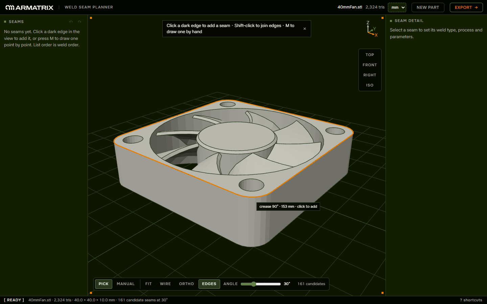
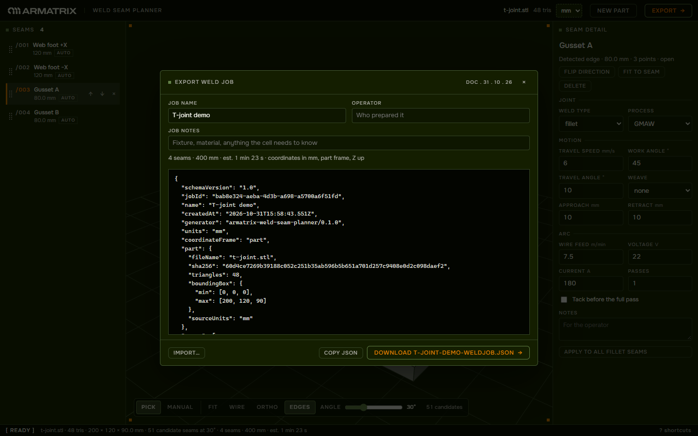

# Weld Seam Planner

Plan robotic welds on a 3D part in the browser. Drop an STL and the app finds the sharp and open edges
where seams usually run. Click the ones to weld, set process parameters and the weld order, then export
a JSON weld job for a robot controller. Nothing is uploaded: parsing, detection and export all run in
your browser.

Built for the Armatrix software intern assignment.

**Live app:** not deployed yet, [run it locally](#run-it-locally) · **Walkthrough video:** to be recorded


## Contents

- [Run it locally](#run-it-locally)
- [Use it](#use-it)
- [What's built](#whats-built)
- [How it's built](#how-its-built)
- [How seam detection works](#how-seam-detection-works)
- [Weld job JSON](#weld-job-json)
- [Testing](#testing)
- [Key decisions](#key-decisions)
- [Brand](#brand)
- [AI tooling](#ai-tooling)

## Run it locally

Requires Node 20 or newer. No environment variables, no backend.

```sh
npm install
npm run dev          # http://localhost:5173 (port taken? npm run dev -- --port 5174)
```

Other commands:

```sh
npm run test         # vitest: parser, topology, detection, seams, store, export, storage, docs sync
npm run build        # type-check, then production bundle in dist/
npm run preview      # serve dist/ at http://localhost:4173
npm run lint         # oxlint
npm run docs:schema  # regenerate the field table in this README from src/export/schema.ts
node scripts/gen-samples.mjs samples   # write the synthetic test parts into samples/
```

## Use it

1. **Load a part.** Drop an `.stl` on the page or click to browse. Binary and ASCII both work, up to
   250 MB. Check the units in the toolbar: `mm`, `in` or `m`. A dashed outline means the app guessed.
2. **Find seams.** Dark lines on the part are candidate seams. The angle slider sets how sharp an edge
   must be to count. Lower it to see more edges, raise it to see fewer.
3. **Pick seams.** Hover a line to see it in orange with its length and angle. Click to add it as a
   seam. Shift-click a touching line to extend the selected seam. Where no line fits, press `M` and
   click points on the part, then press `Enter`.
4. **Set the order.** The seam list is the weld order. Drag rows or press `Shift + ↑/↓`. Numbered chips
   in the view mark where each seam starts, and dashed lines show the torch's moves between seams.
   "Order by nearest" shortens those moves. `F` flips a seam's direction. `Ctrl + Z` undoes any seam
   edit.
5. **Set parameters.** Select a seam to edit its weld type, process, speeds, angles, weave and arc
   settings. "Apply to all fillet seams" copies them to every seam of that type.
6. **Export.** Open Export, fix any errors it lists, then download `<job>-weldjob.json`. Import in the
   same dialog loads a saved job back onto the same part.

The plan saves as you work. Reloading the tab brings back the part, the seams and their settings.
Press `?` in the app for every shortcut.

<details>
<summary><em>All keyboard and mouse controls</em></summary>

<br>

| Input | Action |
|---|---|
| Click | Add the edge under the pointer as a seam, or select its seam |
| `Shift` + click | Join an edge onto the selected seam |
| `M` | Switch between picking edges and drawing a manual seam |
| `Enter` · double-click | Finish the manual seam |
| `Backspace` | Remove the last manual point |
| `Esc` | Cancel the manual seam, the prompt, or the selection |
| `↑` `↓` | Select the previous or next seam |
| `Shift` + `↑` `↓` | Move the selected seam earlier or later in the weld order |
| `F` | Flip the selected seam's direction |
| `Del` | Delete the selected seam |
| `Ctrl` + `Z` | Undo the last seam edit (in manual mode: the last point) |
| `Ctrl` + `Shift` + `Z` · `Ctrl` + `Y` | Redo |
| `R` | Fit the part in view |
| `1` `2` `3` `4` | View from the top, front, right or front-right corner |
| `F2` · double-click | Rename a seam in the list |
| Drag · right-drag · wheel | Orbit · pan · zoom |
| `?` | Show this list |

</details>

## What's built

**Loading.** Reads binary and ASCII STL in a Web Worker, with a progress line. It copes with:

- unmerged vertices, degenerate and duplicate triangles, flipped triangles, non-manifold edges
- unit guessing from the part's size, overridable in the toolbar
- 1M+ triangle parts without freezing the page
- empty, truncated, renamed or non-STL files: each gets a specific message, and the part already
  loaded stays

**Seam detection.** Sharp and open edges are chained into candidate seams. The angle slider (5–90°)
re-chains them without reloading the part. Only edges you can see can be picked.

**Seam editing.**

- Click to add an edge, shift-click to join one on.
- Draw a seam point by point; click the first point to close a loop.
- Rename, reorder (drag or keys), flip and delete seams.
- Undo and redo every seam edit, 50 steps back, with `Ctrl + Z` or the arrows above the list.
- Replacing a part that has seams asks first.

**Sequence and direction.**

- Dashed lines with arrowheads show each move from one seam's end to the next seam's start. They draw
  through the part, so a move behind it still shows.
- The status bar and the export carry the total of those moves (air travel).
- "Order by nearest" reorders the seams so each starts near where the last one ended. The first seam
  stays first. An open seam may be reversed; a loop keeps its start point.
- The selected seam shows short ticks along its torch direction.

**View.** Top, front, right and corner presets (keys `1`–`4`), and an axis triad that shows the part's
own X, Y and Z.

**Parameters.**

- Each seam has its own weld type, process, travel speed, wire feed, voltage, current, passes, weave,
  work and travel angles, approach, retract and tack flag.
- Defaults depend on weld type and process.
- A number field refuses letters.
- Settings copy to every seam of the same weld type.
- The status bar estimates the total weld time, including the moves between seams.

**Export and import.**

- Validation lists errors, which block the download, and warnings, which don't. Clicking an issue
  jumps to its field.
- The dialog shows a JSON preview, copy and download.
- Import checks the part's SHA-256 and asks before applying a plan made for a different part.

**Persistence.** The plan autosaves to `localStorage` and the STL bytes to IndexedDB. Reload restores
both. If the browser dropped the STL, the app asks you to drop the same file again. If storage is
blocked, it says "autosave off" and keeps working.

**Interface.**

- Responsive from 320 px phones (touch orbit and zoom) to 1920 px desktops.
- Keyboard shortcuts for every seam action, and a first-run hint.
- A crash screen that still lets you download your plan.
- Reduced-motion support.
- "How it works" and "Export schema" cards in the empty state. The schema card is generated from the
  same JSDoc as the table below.

**Not built:**

- smoothing or curve fitting of seam paths (they follow mesh edges)
- reachability, collision or robot kinematics checks
- assemblies or several parts per job
- cloud save and share links (designed as plan 06b, see below)
- the shortest possible weld order: "Order by nearest" is a greedy pass, usually shorter but not optimal
- animated playback of the weld sequence
- snapping manual points to edges

## How it's built

Vite, React 18, TypeScript, plain three.js and zustand. No UI kit and no CSS framework.

```
.stl file
  │  sha256 on the main thread (crypto.subtle)
  ▼
Web Worker ─ src/workers/geometry.worker.ts
  │  once per file:   parseStl → mergeVertices → buildEdges → makeContactTest
  │  per slider move: findCandidates(angle)
  │  returns RawMesh (transferred) and Candidate[]
  ▼
zustand store ─ src/store/useStore.ts ──autosave──▶ localStorage (plan) + IndexedDB (STL bytes)
  │  part · candidates · seams in weld order · parameters · job · undo history
  ├──▶ Scene ─ src/viewport/Scene.ts       three.js: mesh, candidate lines, seams, air moves, GPU picking
  ├──▶ panels ─ src/components/            seam list, parameter form, status bar, dialogs
  ▼
export ─ src/export/   toWeldJob → validateJob → JSON download
                       import: parseWeldJob → seamsFromJob
```

- **Pure geometry.** `src/geometry/` holds plain functions on typed arrays, with no three.js imports.
  That makes them unit-testable in Node and movable into a worker. Hash tables are typed-array
  open-addressing tables, because a `Map` with string keys is several times slower at a million
  vertices.
- **Worker boundary.** Parsing, vertex welding and the edge table run once per file in the worker,
  which keeps them in memory. A slider move sends one number and gets candidates back: 7–9 ms on a
  1M-triangle part, measured in Node. Every request carries a sequence number, and only the newest may write
  the store.
- **zustand, not Context or react-three-fiber.** The three.js scene is not React, but it reads and
  writes the same state as the panels. zustand's `getState()` and `subscribe()` work outside React.
  Driving three.js directly keeps the render loop and picking in plain code that can be read line by
  line.
- **Render on demand.** There is no animation loop. A frame renders when the camera moves, the window
  resizes or the store changes.
- **Raw coordinates.** The part keeps its STL coordinates inside a rotated group (Z up). Picked points
  are converted back with `worldToLocal`, so exported points are in the file's own frame, never
  re-centred.
- **Persistence behind one interface.** Everything goes through `src/storage/` (`savePlan`,
  `loadPlan`, `saveFile`, `loadFile`). The saved document is the export JSON plus a little UI state.
  A backend is one more implementation of the same interface that POSTs and GETs that document, keyed
  by the part's SHA-256.

The full log of choices and rejected alternatives is in [`decisions.md`](decisions.md). The workflow
and state model are in [`flow.md`](flow.md). Each feature's plan, with its test results, is in
[`docs/plans/`](docs/plans/).

## How seam detection works

Welds run where two surfaces meet at an angle, or along the open edge of a plate. In a mesh, those are
the edges whose two triangles face different directions. Detection lives in `src/geometry/`.

1. **Weld vertices.** STL stores every triangle with its own copy of each corner. Corners are snapped
   to a grid of `bbox diagonal × 1e-6` and hashed, so shared corners become one vertex. Triangles that
   collapse, and exact duplicates, are dropped.
2. **Build the edge table.** Every unique edge records the triangles on each side.
3. **Measure the dihedral angle.** This is the angle between the two triangles' normals: 0° on a flat
   area, 90° at a square corner. An edge with one triangle is an open edge and counts as 180°.
4. **Fix flipped triangles.** Two neighbours with consistent winding walk their shared edge in
   opposite directions. If they walk it the same way, one is flipped, and its normal is negated before
   measuring. Without this, one bad triangle on a flat face would read as a 180° crease.
5. **Handle non-manifold edges.** An edge shared by three or more triangles keeps its sharpest pair.
6. **Chain into candidates.** Edges at or above the slider angle (default 30°), plus every open edge,
   are joined into polylines. A chain breaks wherever more or fewer than two selected edges meet, so a
   box's rim splits at its corners. Chains shorter than 0.5 % of the part's diagonal are dropped.
7. **Pick a torch direction.** Each point gets the bisector of the two face normals, pointing out of
   the part. Weldments often arrive as separate touching bodies. In that case the edge found is one
   body's own edge, and its bisector points into the other body. `contact.ts` finds faces pressed
   against another body and uses that body's surface instead. On the T-joint, the web's foot seams
   come out at `(±0.707, 0, 0.707)`, up and away from both plates.



**Limits.**

- Smooth or scanned parts have no crisp creases. At low angles, facet noise turns into many short
  candidates.
- A curved seam is a polyline through the mesh's own vertices, as fine as the tessellation.
- Manual mode covers what detection can't: seams across a flat face, on a scan, or anywhere the edges
  don't match the weld. Click points on the surface and each one takes that face's normal.

Picking uses the GPU. A second scene draws a depth-only copy of the part and the candidate lines, each
line coloured with its id. Only a 13 × 13 px window around the pointer is rendered and read back.
Hidden edges can't be picked, and a pick costs 2–6 ms on a 1M-triangle part.

## Weld job JSON

The export format is defined in [`src/export/schema.ts`](src/export/schema.ts), with a one-line comment
on every field. The table below is generated from those comments, and a test fails if the two drift.

What a reader can rely on:

- **Units are always mm**, whatever unit the STL was drawn in. `part.sourceUnits` records the original
  unit; inches scale by 25.4 and metres by 1000.
- **Coordinates are in the part's own frame**, as in the STL, with no re-centring.
- **Seams are in weld order.** `order` is 1-based and matches the array position.
- **Every waypoint has a direction.** `n` is a unit vector pointing away from the part, for torch
  approach.
- **The job is tied to its part.** `part.sha256` is the hash of the exact uploaded bytes.
- **Versioning.** `schemaVersion` is `1.1`. Readers accept any `1.x`; a new major version means a
  breaking change and is refused on import. 1.1 added `summary.airTravelMm`; 1.0 files still import.
- **Rounding.** Coordinates and lengths are rounded to 0.001 mm, with more decimals for parts under about 100 mm
  across. Normals are rounded to 6 decimals.

Example: the T-joint sample with its four seams. Two are shown here; the other two have the same shape.
Regenerate the part with `node scripts/gen-samples.mjs samples` and its `sha256` matches this one.

```jsonc
{
  "schemaVersion": "1.1",
  "jobId": "e1381745-27cb-4be1-9d09-a42a10545827",
  "name": "T-joint demo",
  "createdAt": "2026-10-31T18:58:28.805Z",
  "generator": "armatrix-weld-seam-planner/0.1.0",
  "units": "mm",
  "coordinateFrame": "part",
  "part": {
    "fileName": "t-joint.stl",
    "sha256": "60d4ce7269b39188c052c251b35ab596b5b651a701d257c9408e0d2c098daef2",
    "triangles": 48,
    "boundingBox": {
      "min": [0, 0, 0],
      "max": [200, 120, 90]
    },
    "sourceUnits": "mm"
  },
  "seams": [
    {
      "id": "3b050a00-db68-4b35-9898-a381f27af7ee",
      "order": 1,
      "name": "Web foot +X",
      "source": "auto",
      "closed": false,
      "lengthMm": 120,
      "parameters": {
        "weldType": "fillet",
        "process": "GMAW",
        "travelSpeedMmS": 6,
        "wireFeedMMin": 7.5,
        "voltageV": 22,
        "currentA": 180,
        "passes": 1,
        "weave": {
          "pattern": "none"
        },
        "workAngleDeg": 45,
        "travelAngleDeg": 10,
        "approachMm": 10,
        "retractMm": 10,
        "tackFirst": false
      },
      "path": [
        {
          "p": [105, 120, 10],
          "n": [0.707107, 0, 0.707107]
        },
        {
          "p": [105, 0, 10],
          "n": [0.707107, 0, 0.707107]
        }
      ]
    },
    // seam 2, "Web foot −X": the same on the other side of the web
    {
      "id": "731b3c9a-bcdf-4526-bff2-cd81055a0752",
      "order": 3,
      "name": "Gusset A",
      "source": "auto",
      "closed": false,
      "lengthMm": 80,
      "parameters": { /* same as seam 1 */ },
      "path": [
        {
          "p": [145, 15, 10],
          "n": [0, -0.707107, 0.707107]
        },
        {
          "p": [105, 15, 10],
          "n": [0, -0.707107, 0.707107]
        },
        {
          "p": [105, 15, 50],
          "n": [0.707107, -0.707107, 0]
        }
      ]
    }
    // seam 4, "Gusset B": the mirror of Gusset A
  ],
  "summary": {
    "seamCount": 4,
    "totalLengthMm": 400,
    "airTravelMm": 232.598,
    "estimatedTimeS": 85
  }
}
```

"Gusset A" was made by clicking the gusset's foot and shift-clicking its upright edge. The direction
turns at the corner, where the torch moves from the plate to the web. The 232.6 mm of air travel is
10 mm across the web's foot, then two long moves to each gusset; "Order by nearest" would shorten it.

`?` after a field name means the field can be absent. A unit column entry means every value of that
field is in that unit.

<!-- schema:start -->

| Field | Type | Unit | Meaning |
|---|---|---|---|
| `schemaVersion` | `"1.1"` |  | Format version; readers accept any 1.x. |
| `jobId` | `string` |  | Job id (uuid), stable across re-exports of the same plan. |
| `name` | `string` |  | Job label; defaults to the part file name without extension. |
| `createdAt` | `string` |  | Export time, ISO-8601 UTC. |
| `generator` | `string` |  | Tool and version that wrote the file. |
| `operator?` | `string` |  | Who prepared the job. |
| `notes?` | `string` |  | Job-level notes. |
| `units` | `"mm"` |  | Length unit of every coordinate and length in the file. Always mm. |
| `coordinateFrame` | `"part"` |  | Coordinates are the STL's own frame, Z up as in the file, not re-centred. |
| `part` | `object` |  | The part the job was planned on. |
| `part.fileName` | `string` |  | Uploaded file name. |
| `part.sha256` | `string` |  | SHA-256 of the uploaded bytes; import refuses a different part unless forced. |
| `part.triangles` | `number` |  | Triangle count after dropping degenerate triangles. |
| `part.boundingBox` | `{ min: [x, y, z]; max: [x, y, z] }` | mm | Axis-aligned bounds in mm. |
| `part.sourceUnits` | `"mm" \| "in" \| "m"` |  | Unit the STL was drawn in, as confirmed by the user; in is scaled by 25.4, m by 1000. |
| `seams` | `array` |  | Seams in weld order. |
| `seams[].id` | `string` |  | Stable seam id (uuid). |
| `seams[].order` | `number` |  | 1-based position in the weld sequence. |
| `seams[].name` | `string` |  | User label, e.g. S-01. |
| `seams[].source` | `"auto" \| "manual"` |  | auto = picked from a detected edge; manual = clicked point by point. |
| `seams[].closed` | `boolean` |  | True when the path is a loop: the robot returns to the first waypoint. |
| `seams[].lengthMm` | `number` | mm | Path length in mm, including the closing segment of a loop. |
| `seams[].parameters` | `object` |  | Process settings for this seam. |
| `seams[].parameters.weldType` | `"fillet" \| "butt" \| "lap" \| "groove"` |  | Joint geometry the seam belongs to. |
| `seams[].parameters.process` | `"GMAW" \| "GTAW" \| "FCAW"` |  | Arc process: GMAW (MIG/MAG), GTAW (TIG) or FCAW (flux-cored). |
| `seams[].parameters.travelSpeedMmS` | `number` | mm/s | Torch speed along the seam, mm/s. |
| `seams[].parameters.wireFeedMMin` | `number` | m/min | Wire feed speed, m/min; 0 for autogenous GTAW. |
| `seams[].parameters.voltageV` | `number` | V | Arc voltage, V. |
| `seams[].parameters.currentA` | `number` | A | Welding current, A. |
| `seams[].parameters.passes` | `number` |  | Number of passes; each pass repeats the path. At least 1. |
| `seams[].parameters.weave` | `object` |  | Torch oscillation across the seam. |
| `seams[].parameters.weave.pattern` | `"none" \| "zigzag" \| "circular"` |  | Oscillation shape; none = straight travel. |
| `seams[].parameters.weave.amplitudeMm?` | `number` | mm | Half-width of the oscillation, mm. Present when pattern is not none. |
| `seams[].parameters.weave.frequencyHz?` | `number` | Hz | Oscillations per second, Hz. Present when pattern is not none. |
| `seams[].parameters.workAngleDeg` | `number` | ° | Torch tilt across the seam, degrees from the surface (45 for a fillet). |
| `seams[].parameters.travelAngleDeg` | `number` | ° | Torch tilt along travel, degrees; positive = push, negative = drag. |
| `seams[].parameters.approachMm` | `number` | mm | Distance before the first waypoint where the torch starts its approach, mm. |
| `seams[].parameters.retractMm` | `number` | mm | Distance past the last waypoint before the torch retracts, mm. |
| `seams[].parameters.tackFirst` | `boolean` |  | Tack the seam at intervals before the full pass. |
| `seams[].path` | `array` |  | Waypoints in weld direction. |
| `seams[].path[].p` | `[x, y, z]` | mm | Position in mm, part coordinates. |
| `seams[].path[].n` | `[x, y, z]` |  | Unit torch-approach direction, pointing away from the part: the face normal, or at an edge the bisector of the two surfaces that meet there. |
| `seams[].notes?` | `string` |  | Free text for the operator. |
| `summary` | `object` |  | Totals computed at export. |
| `summary.seamCount` | `number` |  | Number of seams. |
| `summary.totalLengthMm` | `number` | mm | Sum of seam lengths, mm. |
| `summary.airTravelMm` | `number` | mm | Sum of the straight moves from each seam's end to the next seam's start, mm. Added in 1.1. |
| `summary.estimatedTimeS` | `number` | s | Arc time (length / speed × passes), plus air travel at 100 mm/s, plus a fixed start/stop allowance per seam, s. |

<!-- schema:end -->



## Testing

`npm run test` runs the vitest suites:

- the STL parser: binary, ASCII, CRLF, scientific notation, padding, NaN, truncated and empty files
- vertex welding and the edge table: winding flips, non-manifold edges, degenerate triangles
- candidate chaining and contact faces, with exact candidate counts on the generated parts
- seam operations: join in all four end pairings, flip, loop start, geometric ownership
- the store: load races, join and toggle rules, manual mode, replace-part prompts, apply-to-type, import
- export: defaults for every weld type and process, unit scaling, every validation rule, round trip
- storage, with in-memory stubs for `localStorage` and IndexedDB, including quota errors
- brand tokens against `brand.md`, and this README's schema table against `schema.ts`

The app was also checked end to end in headless Chrome (puppeteer-core with the real GPU). The checks
drop real files, click, drag, type, reload and download. 172 checks pass across the dev server and the
production build, at widths from 360 px with touch to 1440 px.

<details>
<summary><em>Test parts and what each one exercises</em></summary>

<br>

The parts live in `samples/`, which is not in the repo because of size and licensing. Regenerate the
synthetic ones with `node scripts/gen-samples.mjs samples`.

| Part | Triangles | Exercises |
|---|---|---|
| `t-joint.stl` | 48 | A weldment of five separate touching bodies: plate, web and three gussets. Torch direction at contact faces. Exactly 51 candidates at 30°. |
| `40mmFan.stl` | 2,324 | A real binary STL from Thingiverse. Hole rims become closed loops. |
| `40mmFan-ascii.stl` | 2,324 | ASCII with CRLF and scientific notation. Gives the same 161 candidates as the binary. |
| `fan-meters.stl` | 2,324 | The fan in metres: units can't be guessed and must be set. It exports as a 40 mm part. |
| `tube-on-plate-big.stl` | 1,052,684 | 52.6 MB. Load time, picking speed, manual raycast, restore from IndexedDB. |
| `noisy-scan.stl` | ~980,000 | A jittered surface. Facet noise and the slowest re-chain, at 5°. |
| `empty.stl`, `truncated.stl`, `renamed-text.stl`, `bracket.obj` | | Each gets its own error message, and the loaded part survives. |

</details>

<details>
<summary><em>Browser checks and measured performance</em></summary>

<br>

| Suite | Checks | Covers |
|---|---|---|
| Seam picking | 28 | Hidden edges not pickable, hover, add, join, refused join, flip, reorder by key and drag, rename, delete, replace-part prompt, fan hole loop, manual loop on the 1M-triangle part |
| Parameters and export | 26 | Field validation, weave fields, reset, apply-to-all, export preview, download, `Esc` and focus return, clickable issues, import round trip, wrong-part import, unknown units, metres |
| Persistence and polish | 21 | Autosave, reload restore, missing-file path, discard, New part, shortcuts, runtime errors, crash screen with plan download, blocked storage |
| Responsive | 20 | 1024 px, then 768, 390 and 360 px with touch: layout, touch orbit, no horizontal scroll |
| Performance | 7 | Picking time, manual raycast, 5° re-chain, CPU throttled 4× |
| Restore | 5 | The fan and the 52.6 MB part restore from IndexedDB |
| Export on three parts | 5 | T-joint, fan and tube export valid jobs |
| Order, direction, undo, views | 53 | Air lines and totals, order by nearest and its undo, undo/redo by key and button, text fields keep their own undo, torch ticks lean off both plates, ≤ 64 ticks on a 1,024-point loop with no frame-time cost, view presets in both projections, triad at three widths, schema 1.1 download |
| Production build | 7 | Same flows on `vite preview`, including a 64-character SHA-256 |

Measured on the development laptop, 1M-triangle part:

- drop to ready: about 1–6 s including reading the file (timings swing 3–5× between runs on this
  hybrid CPU)
- pick under the pointer: 2–6 ms median; 6–13 ms with the CPU throttled 4×
- slider re-chain: 7–9 ms in Node; the noisy scan at 5° takes 1–2 s in the worker, and the page stays
  live

The browser suites run from a scratch folder, outside the repo, so `puppeteer-core` is not a project
dependency.

</details>

**Known limitations:** Chrome and Edge only so far; Firefox and Safari haven't been checked. Weld
parameters are starting values, not a qualified welding procedure. Plans are saved in this browser
only.

## Key decisions

- **Plain three.js, not react-three-fiber.** The render loop and picking stay visible in plain code.
- **Geometry as pure typed-array functions in a worker.** They can be tested in Node, and a 1M-triangle
  part never blocks the page.
- **GPU picking instead of raycasting lines.** A line raycast also hits edges behind the part.
- **Seams own their points.** Candidates are re-derived and their ids change with the slider, so the
  app matches a seam to its edge by geometry, not by stored ids. Export never depends on re-running
  detection.
- **One document for export and autosave.** It is always in mm, in the part's frame, and tied to the
  part's SHA-256. A future backend stores the same document.

Every other decision, with the alternative it rejected, is in [`decisions.md`](decisions.md).

## Brand

The app uses the Armatrix palette and type from the brand pack. [`brand.md`](brand.md) has the values,
and `src/styles/tokens.css` holds them as CSS variables. A test keeps the two in sync.

- **Dark theme.** Dark Forest backgrounds, Light Sand text, and a sand-coloured matte part.
- **Green means structure, orange means action.** Revolution Green marks borders, candidate lines and
  placed seams. Bright Discovery orange is only for the primary button, the hovered edge, the
  selected seam and warnings.
- **Type.** Onest for labels, buttons and numbers, uppercase and tracked as the guideline asks.
  42dot Sans for help text. Both are self-hosted Latin subsets, about 30 KB each.

## AI tooling

I built this with Claude Code (Anthropic) as a pair programmer. It helped with planning,
implementation, tests and the headless browser checks. I reviewed every module and can explain each
choice. `docs/plans/` shows how the work was split into features, each planned before it was built,
and `decisions.md` records why each choice was made.

---

© 2026 Arnav Gupta. All rights reserved.
