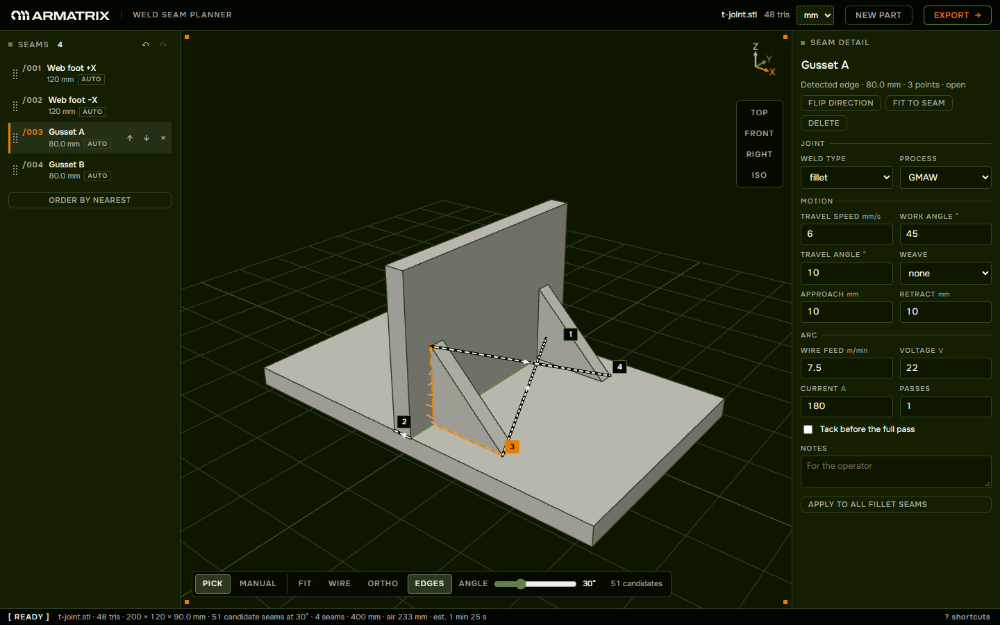

# Weld Seam Planner

Plan robotic welds on a 3D part in the browser. Drop an STL and the app finds the sharp and open edges
where seams usually run. Click the ones to weld, set process parameters and the weld order, then export
a JSON weld job for a robot controller. Nothing is uploaded: parsing, detection and export all run in
your browser.

Built for the Armatrix software intern assignment.

**Live app:** [armatrix-weld-seam-planner.vercel.app](https://armatrix-weld-seam-planner.vercel.app/)



## Contents

- [Run it locally](#run-it-locally)
- [Use it](#use-it)
- [Features](#features)
- [Architecture and design decisions](#architecture-and-design-decisions)
- [Weld job JSON schema](#weld-job-json-schema)
- [Brand](#brand)
- [AI tooling](#ai-tooling)

## Run it locally

Requires Node 20 or newer. No environment variables, no backend.

```sh
npm install
npm run dev          # http://localhost:5173 (port taken? npm run dev -- --port 5174)
```

## Use it

1. **Load a part.** Drop an `.stl` on the page or click to browse. Binary and ASCII both work, up to
   250 MB. Check the units in the toolbar: `mm`, `in` or `m`. A dashed outline means the app guessed.
2. **Find seams.** Dark lines on the part are candidate seams. The angle slider sets how sharp an edge
   must be to count: lower it to see more edges, raise it to see fewer.
3. **Pick seams.** Hover a line to see its length and angle, click to add it as a seam. Shift-click a
   touching line to extend the selected seam. Where no line fits, press `M` and click points on the
   part, then press `Enter`.
4. **Set the order.** The seam list is the weld order. Drag rows or press `Shift + ↑/↓`. Numbered chips
   mark where each seam starts, dashed lines show the torch's moves between seams, and "Order by
   nearest" shortens them. `F` flips a seam's direction. `Ctrl + Z` undoes any seam edit.
5. **Set parameters.** Select a seam to edit its weld type, process, speeds, angles, weave and arc
   settings. "Apply to all fillet seams" copies them to every seam of that type.
6. **Export.** The Export button counts the problems waiting: orange for errors, sand for warnings. Open
   it, fix any errors it lists, then download `<job>-weldjob.json`. Import in the same dialog loads a
   saved job back onto the same part.

The plan saves as you work; reloading the tab brings back the part, the seams and their settings.
Press `?` in the app for every keyboard and mouse control. The same walkthrough and the field table
below are one click away inside the app: **How it works** and **Export schema** in the empty state.

## Features

- **Any STL.** Binary and ASCII, parsed in a Web Worker with a progress line. Copes with unmerged
  vertices, degenerate, duplicate and flipped triangles and non-manifold edges. Units are guessed from
  the part's size and can be overridden. Empty, truncated, renamed or non-STL files each get a specific
  message, and the part already loaded stays. 1M+ triangle parts load without freezing the page.
- **Seam detection.** Sharp and open edges are chained into candidate seams. The angle slider (5–90°)
  re-chains them without reloading the part. Only edges you can see can be picked. The torch direction
  stays correct where separate touching bodies meet, which is how most weldments arrive.
- **Manual seams.** Draw a seam point by point on any surface; click the first point to close a loop.
- **Weld order.** Each row reads as a line of the job (`120 mm · fillet · GMAW · 24 s`) and a totals
  card adds up seams, length, weld time and air travel. Dashed lines with arrowheads show every move
  between seams, drawn through the part so a move behind it still shows. "Order by nearest" reorders
  the seams so each starts near where the last one ended. Rename, reorder, flip and delete, with 50
  steps of undo and redo.
- **Parameters.** Each seam has its own weld type, process, travel speed, wire feed, voltage, current,
  passes, weave, work and travel angles, approach, retract and tack flag. Defaults depend on weld type
  and process, and settings copy to every seam of the same type.
- **Export and import.** Validation lists errors, which block the download, and warnings, which don't;
  clicking an issue jumps to its field. The dialog shows a JSON preview with copy and download. Import
  checks the part's SHA-256 and asks before applying a plan made for a different part.
- **Persistence.** The plan autosaves to `localStorage` and the STL bytes to IndexedDB, and a reload
  restores both. If storage is blocked the app says "autosave off" and keeps working.
- **Interface.** View presets (`1`–`4`) and an axis triad in the part's own frame. Works from 320 px
  phones with touch orbit to 4K screens. Keyboard shortcuts for every seam action. A crash screen that
  still lets you download the plan. Reduced motion respected. "How it works" and "Export schema" cards
  in the empty state, the schema card generated from the same source as the table below.

Known limitations: checked in Chrome and Edge only. Weld parameters are starting values, not a
qualified welding procedure. Plans are saved in this browser only.

## Architecture and design decisions

Vite, React 18, TypeScript, plain three.js and zustand. No UI kit and no CSS framework.

```
.stl file
  │  sha256 on the main thread (crypto.subtle)
  ▼
Web Worker ─ src/workers/geometry.worker.ts
  │  once per file:   parseStl → mergeVertices → buildEdges → makeContactTest
  │  per slider move: findCandidates(angle)
  │  returns RawMesh (transferred) and Candidate[]
  ▼
zustand store ─ src/store/useStore.ts ──autosave──▶ localStorage (plan) + IndexedDB (STL bytes)
  │  part · candidates · seams in weld order · parameters · job · undo history
  ├──▶ Scene ─ src/viewport/Scene.ts       three.js: mesh, candidate lines, seams, air moves, GPU picking
  ├──▶ panels ─ src/components/            seam list, parameter form, status bar, dialogs
  ▼
export ─ src/export/   toWeldJob → validateJob → JSON download
                       import: parseWeldJob → seamsFromJob
```

- **Pure geometry in a Web Worker.** `src/geometry/` is plain functions on typed arrays with no three.js
  imports, so it runs in Node and in the worker alike. Parsing, vertex welding and the edge table run
  once per file and stay in worker memory; a slider move sends one number and gets candidates back,
  7–9 ms on a 1M-triangle part. Hash tables are typed-array open-addressing tables, because a `Map`
  with string keys is several times slower at a million vertices. Every request carries a sequence
  number and only the newest may write the store.
- **Plain three.js with zustand, not react-three-fiber or Context.** The scene is not React, but it
  reads and writes the same state as the panels, and zustand's `getState()` and `subscribe()` work
  outside React. The render loop and picking stay in plain code that can be read line by line. There
  is no animation loop: a frame renders when the camera moves, the window resizes or the store changes.
- **GPU picking, not line raycasting.** A second scene draws a depth-only copy of the part and the
  candidate lines, each coloured with its id, and only a 13 × 13 px window around the pointer is
  rendered and read back. Hidden edges can't be picked, which a line raycast gets wrong, and a pick
  costs 2–6 ms on a 1M-triangle part.
- **Raw coordinates.** The part keeps its STL coordinates inside a rotated group (Z up). Picked points
  are converted back with `worldToLocal`, so exported points are in the file's own frame, never
  re-centred.
- **Seams own their points.** Candidates are re-derived and their ids change with the slider, so a seam
  matches its edge by geometry, not by stored ids. Export never depends on re-running detection.
- **One document for export and autosave.** Always in mm, in the part's frame, tied to the part's
  SHA-256, and read and written through one interface in `src/storage/` (`savePlan`, `loadPlan`,
  `saveFile`, `loadFile`). A backend is one more implementation of that interface that POSTs and GETs
  the same document.

### How seam detection works

Welds run where two surfaces meet at an angle, or along the open edge of a plate. In a mesh, those are
the edges whose two triangles face different directions. Detection lives in `src/geometry/`.

1. **Weld vertices.** STL stores every triangle with its own copy of each corner. Corners are snapped
   to a grid of `bbox diagonal × 1e-6` and hashed, so shared corners become one vertex. Triangles that
   collapse, and exact duplicates, are dropped.
2. **Build the edge table.** Every unique edge records the triangles on each side.
3. **Measure the dihedral angle.** This is the angle between the two triangles' normals: 0° on a flat
   area, 90° at a square corner. An edge with one triangle is an open edge and counts as 180°.
4. **Fix flipped triangles.** Two neighbours with consistent winding walk their shared edge in
   opposite directions. If they walk it the same way, one is flipped, and its normal is negated before
   measuring. Without this, one bad triangle on a flat face would read as a 180° crease.
5. **Handle non-manifold edges.** An edge shared by three or more triangles keeps its sharpest pair.
6. **Chain into candidates.** Edges at or above the slider angle (default 30°), plus every open edge,
   are joined into polylines. A chain breaks wherever more or fewer than two selected edges meet, so a
   box's rim splits at its corners. Chains shorter than 0.5 % of the part's diagonal are dropped.
7. **Pick a torch direction.** Each point gets the bisector of the two face normals, pointing out of
   the part. Weldments often arrive as separate touching bodies. In that case the edge found is one
   body's own edge, and its bisector points into the other body. `contact.ts` finds faces pressed
   against another body and uses that body's surface instead. On the T-joint, the web's foot seams
   come out at `(±0.707, 0, 0.707)`, up and away from both plates.


## Weld job JSON schema

The export format is defined in [`src/export/schema.ts`](src/export/schema.ts), with a one-line comment
on every field. The table below is generated from those comments.

What a reader can rely on:

- **Units are always mm**, whatever unit the STL was drawn in. `part.sourceUnits` records the original
  unit; inches scale by 25.4 and metres by 1000.
- **Coordinates are in the part's own frame**, as in the STL, with no re-centring.
- **Seams are in weld order.** `order` is 1-based and matches the array position.
- **Every waypoint has a direction.** `n` is a unit vector pointing away from the part, for torch
  approach.
- **The job is tied to its part.** `part.sha256` is the hash of the exact uploaded bytes.
- **Versioning.** `schemaVersion` is `1.1`. Readers accept any `1.x`; a new major version means a
  breaking change and is refused on import. 1.1 added `summary.airTravelMm`; 1.0 files still import.
- **Rounding.** Coordinates and lengths are rounded to 0.001 mm, with more decimals for parts under about 100 mm
  across. Normals are rounded to 6 decimals.

<details>
<summary><em>Example: the T-joint sample with four seams (abridged)</em></summary>

<br>

Example: the T-joint sample with its four seams. Two are shown here; the other two have the same shape.
Regenerate the part with `node scripts/gen-samples.mjs samples` and its `sha256` matches this one.

```jsonc
{
  "schemaVersion": "1.1",
  "jobId": "e1381745-27cb-4be1-9d09-a42a10545827",
  "name": "T-joint demo",
  "createdAt": "2026-10-31T18:58:28.805Z",
  "generator": "armatrix-weld-seam-planner/0.1.0",
  "units": "mm",
  "coordinateFrame": "part",
  "part": {
    "fileName": "t-joint.stl",
    "sha256": "60d4ce7269b39188c052c251b35ab596b5b651a701d257c9408e0d2c098daef2",
    "triangles": 48,
    "boundingBox": {
      "min": [0, 0, 0],
      "max": [200, 120, 90]
    },
    "sourceUnits": "mm"
  },
  "seams": [
    {
      "id": "3b050a00-db68-4b35-9898-a381f27af7ee",
      "order": 1,
      "name": "Web foot +X",
      "source": "auto",
      "closed": false,
      "lengthMm": 120,
      "parameters": {
        "weldType": "fillet",
        "process": "GMAW",
        "travelSpeedMmS": 6,
        "wireFeedMMin": 7.5,
        "voltageV": 22,
        "currentA": 180,
        "passes": 1,
        "weave": {
          "pattern": "none"
        },
        "workAngleDeg": 45,
        "travelAngleDeg": 10,
        "approachMm": 10,
        "retractMm": 10,
        "tackFirst": false
      },
      "path": [
        {
          "p": [105, 120, 10],
          "n": [0.707107, 0, 0.707107]
        },
        {
          "p": [105, 0, 10],
          "n": [0.707107, 0, 0.707107]
        }
      ]
    },
    // seam 2, "Web foot −X": the same on the other side of the web
    {
      "id": "731b3c9a-bcdf-4526-bff2-cd81055a0752",
      "order": 3,
      "name": "Gusset A",
      "source": "auto",
      "closed": false,
      "lengthMm": 80,
      "parameters": { /* same as seam 1 */ },
      "path": [
        {
          "p": [145, 15, 10],
          "n": [0, -0.707107, 0.707107]
        },
        {
          "p": [105, 15, 10],
          "n": [0, -0.707107, 0.707107]
        },
        {
          "p": [105, 15, 50],
          "n": [0.707107, -0.707107, 0]
        }
      ]
    }
    // seam 4, "Gusset B": the mirror of Gusset A
  ],
  "summary": {
    "seamCount": 4,
    "totalLengthMm": 400,
    "airTravelMm": 232.598,
    "estimatedTimeS": 85
  }
}
```

"Gusset A" was made by clicking the gusset's foot and shift-clicking its upright edge. The direction
turns at the corner, where the torch moves from the plate to the web. The 232.6 mm of air travel is
10 mm across the web's foot, then two long moves to each gusset; "Order by nearest" would shorten it.

</details>

`?` after a field name means the field can be absent. A unit column entry means every value of that
field is in that unit.

<!-- schema:start -->

| Field | Type | Unit | Meaning |
|---|---|---|---|
| `schemaVersion` | `"1.1"` |  | Format version; readers accept any 1.x. |
| `jobId` | `string` |  | Job id (uuid), stable across re-exports of the same plan. |
| `name` | `string` |  | Job label; defaults to the part file name without extension. |
| `createdAt` | `string` |  | Export time, ISO-8601 UTC. |
| `generator` | `string` |  | Tool and version that wrote the file. |
| `operator?` | `string` |  | Who prepared the job. |
| `notes?` | `string` |  | Job-level notes. |
| `units` | `"mm"` |  | Length unit of every coordinate and length in the file. Always mm. |
| `coordinateFrame` | `"part"` |  | Coordinates are the STL's own frame, Z up as in the file, not re-centred. |
| `part` | `object` |  | The part the job was planned on. |
| `part.fileName` | `string` |  | Uploaded file name. |
| `part.sha256` | `string` |  | SHA-256 of the uploaded bytes; import refuses a different part unless forced. |
| `part.triangles` | `number` |  | Triangle count after dropping degenerate triangles. |
| `part.boundingBox` | `{ min: [x, y, z]; max: [x, y, z] }` | mm | Axis-aligned bounds in mm. |
| `part.sourceUnits` | `"mm" \| "in" \| "m"` |  | Unit the STL was drawn in, as confirmed by the user; in is scaled by 25.4, m by 1000. |
| `seams` | `array` |  | Seams in weld order. |
| `seams[].id` | `string` |  | Stable seam id (uuid). |
| `seams[].order` | `number` |  | 1-based position in the weld sequence. |
| `seams[].name` | `string` |  | User label, e.g. S-01. |
| `seams[].source` | `"auto" \| "manual"` |  | auto = picked from a detected edge; manual = clicked point by point. |
| `seams[].closed` | `boolean` |  | True when the path is a loop: the robot returns to the first waypoint. |
| `seams[].lengthMm` | `number` | mm | Path length in mm, including the closing segment of a loop. |
| `seams[].parameters` | `object` |  | Process settings for this seam. |
| `seams[].parameters.weldType` | `"fillet" \| "butt" \| "lap" \| "groove"` |  | Joint geometry the seam belongs to. |
| `seams[].parameters.process` | `"GMAW" \| "GTAW" \| "FCAW"` |  | Arc process: GMAW (MIG/MAG), GTAW (TIG) or FCAW (flux-cored). |
| `seams[].parameters.travelSpeedMmS` | `number` | mm/s | Torch speed along the seam, mm/s. |
| `seams[].parameters.wireFeedMMin` | `number` | m/min | Wire feed speed, m/min; 0 for autogenous GTAW. |
| `seams[].parameters.voltageV` | `number` | V | Arc voltage, V. |
| `seams[].parameters.currentA` | `number` | A | Welding current, A. |
| `seams[].parameters.passes` | `number` |  | Number of passes; each pass repeats the path. At least 1. |
| `seams[].parameters.weave` | `object` |  | Torch oscillation across the seam. |
| `seams[].parameters.weave.pattern` | `"none" \| "zigzag" \| "circular"` |  | Oscillation shape; none = straight travel. |
| `seams[].parameters.weave.amplitudeMm?` | `number` | mm | Half-width of the oscillation, mm. Present when pattern is not none. |
| `seams[].parameters.weave.frequencyHz?` | `number` | Hz | Oscillations per second, Hz. Present when pattern is not none. |
| `seams[].parameters.workAngleDeg` | `number` | ° | Torch tilt across the seam, degrees from the surface (45 for a fillet). |
| `seams[].parameters.travelAngleDeg` | `number` | ° | Torch tilt along travel, degrees; positive = push, negative = drag. |
| `seams[].parameters.approachMm` | `number` | mm | Distance before the first waypoint where the torch starts its approach, mm. |
| `seams[].parameters.retractMm` | `number` | mm | Distance past the last waypoint before the torch retracts, mm. |
| `seams[].parameters.tackFirst` | `boolean` |  | Tack the seam at intervals before the full pass. |
| `seams[].path` | `array` |  | Waypoints in weld direction. |
| `seams[].path[].p` | `[x, y, z]` | mm | Position in mm, part coordinates. |
| `seams[].path[].n` | `[x, y, z]` |  | Unit torch-approach direction, pointing away from the part: the face normal, or at an edge the bisector of the two surfaces that meet there. |
| `seams[].notes?` | `string` |  | Free text for the operator. |
| `summary` | `object` |  | Totals computed at export. |
| `summary.seamCount` | `number` |  | Number of seams. |
| `summary.totalLengthMm` | `number` | mm | Sum of seam lengths, mm. |
| `summary.airTravelMm` | `number` | mm | Sum of the straight moves from each seam's end to the next seam's start, mm. Added in 1.1. |
| `summary.estimatedTimeS` | `number` | s | Arc time (length / speed × passes), plus air travel at 100 mm/s, plus a fixed start/stop allowance per seam, s. |

<!-- schema:end -->


## Brand

The app uses the Armatrix palette and type from the brand pack: the values are in
[`brand.md`](brand.md) and `src/styles/tokens.css` holds them as CSS variables. Dark Forest
backgrounds, Light Sand text and a sand-coloured matte part. Green means structure: borders, candidate
lines and placed seams. Orange means action: the primary button, the hovered edge, the selected seam
and warnings. Onest for labels, buttons and numbers, uppercase and tracked as the guideline asks, and
42dot Sans for help text; both are self-hosted Latin subsets of about 30 KB.

## AI tooling

I built this with Claude Code (Anthropic) as a pair programmer. It helped with planning,
implementation and verification. I reviewed every module and can explain each
choice.

---

© 2026 Arnav Gupta. All rights reserved.
